# ⚡ Awesome JavaScript Version Managers

  <strong>Curated Directory of Open-Source Version Managers, Cloud Development Environments (CDEs), and Toolchain Pinning Solutions for JavaScript, Node.js, Deno, and Bun</strong>

  
  
  
  
  
  

  <em>Eliminate "works on my machine" bugs. Seamlessly install, pin, switch, and automate Node.js runtime versions across local terminal shells, CI/CD deployment pipelines, and remote cloud dev environments.</em>

---

## 📑 Table of Contents

- [🔍 Sector Overview & Market Dynamics](#-sector-overview--market-dynamics)
- [☁️ SaaS & Hosted Cloud Workspaces](#️-saas--hosted-cloud-workspaces)
- [🛠️ Open-Source JavaScript Version Managers](#️-open-source-javascript-version-managers)
- [🧭 Decision Matrix & Recommendations](#-decision-matrix--recommendations)
- [🤝 How to Contribute](#-how-to-contribute)
- [💖 Support & Sponsorship](#-support--sponsorship)
- [⭐ Star History](#-star-history)
- [📜 Disclaimer](#-disclaimer)

---

## 🔍 Sector Overview & Market Dynamics

The **Cloud Development Environment (CDE)** and cloud workspace market is an emerging high-growth segment nested within the broader **$1+ trillion** global cloud services ecosystem, driven by enterprise demands for standardized, reproducible dev toolchains, zero-config onboarding, and AI coding agents. 

The sector exhibits a **moderately concentrated market dynamic at the top**, where hyperscaler and source-control giants (Microsoft/GitHub Codespaces, GitLab Workspaces) leverage captive developer ecosystems. Concurrently, it remains **fragmented across specialized, venture-backed independent CDE providers** (such as Replit, StackBlitz, Coder, and Gitpod) competing aggressively on instant WebContainers-based browser execution, air-gapped security compliance, and self-hosted Kubernetes control.

---

## ☁️ SaaS & Hosted Cloud Workspaces

> 💡 *Note: Dedicated CLI JavaScript version managers (like `nvm` or `fnm`) execute locally inside your shell. However, Cloud Development Environments (CDEs) and browser runtime platforms offer full SaaS workflows that automate runtime versioning, pre-bake Node.js/JS toolchains, and completely eradicate local configuration drift across teams.*

| Platform | Starting Tier Pricing | Free Tier Limit | Company Size (Valuation / Revenue) | Description |
| :--- | :--- | :--- | :--- | :--- |
| **[GitHub Codespaces](https://github.com/features/codespaces)** | $0.18/hour (2-core pay-as-you-go) or GitHub Team ($4/user/month) / Enterprise ($21/user/month) | 120 core hours/month (60 hours on 2-core VM) + 15 GB-months storage | **$3+ Trillion** (Parent: Microsoft market cap; GitHub acquisition $7.5B, estimated $2B+ ARR) | Cloud development environments powered by devcontainers with automated Node.js version switching and native VS Code integration. |
| **[Replit](https://replit.com)** | $20/month ($18/month billed annually) for Core plan | Basic compute (1 vCPU, 2 GiB RAM), 1 published app (sleeps after inactivity), limited daily Agent credits | **$9.0 Billion** valuation (Series C; ~$150M+ ARR) | Cloud-hosted development workspace with automated runtime detection, integrated package management, and AI coding agents. |
| **[GitLab Workspaces](https://about.gitlab.com)** | $29/user/month (GitLab Premium, billed annually at $348/user/year) | 5 users/namespace, 400 CI/CD compute mins/month, 10 GiB storage (Remote Workspaces feature requires Premium) | **~$6.3 Billion - $9.1 Billion** market cap (Public: NASDAQ: GTLB; ~$750M FY2025 revenue) | Remote development workspaces running containerized environments with pre-pinned toolchains directly tied to GitLab CI/CD pipelines. |
| **[StackBlitz](https://stackblitz.com)** | $25/month ($18/month billed annually) for Pro plan | Unlimited public projects, 1 MB file upload limit, full browser-based WebContainers runtime | **$700 Million** valuation (Series B; creators of Bolt.new and WebContainers) | Instant browser-based Node.js runtime environment powered by WebContainers, booting in milliseconds without local installation. |
| **[Coder](https://coder.com)** | $35/user/month (Enterprise starting tier) | Open-source self-hosted tier is free for community use; hosted enterprise trials available | **~$380 Million - $396 Million** valuation (Series C led by KKR; $175M total raised) | Enterprise-grade cloud development environment platform provisioning secure developer workspaces across any cloud or on-prem Kubernetes cluster. |
| **[Gitpod](https://gitpod.io)** | $20/month for Pay-as-you-go Core plan | 500 workspace credits/month (~50 hours standard workspace runtime) | **~$100 Million+** valuation (Series A $25M; pioneer in open-source & automated CDEs) | Ephemeral, automated cloud developer workspaces pre-configured with project runtimes, dependencies, and extensions. |

---

## 🛠️ Open-Source JavaScript Version Managers

*Ranked in descending order by GitHub_Stars ⭐. Each tool includes live social Stars_Badges linking directly to that project's stargazers.*

### 1. **[nvm (Node Version Manager)](https://github.com/nvm-sh/nvm)** 
* **Overview**: The universal POSIX shell standard for managing multiple active Node.js versions.
* **Key Features**: Lowest learning curve, ubiquitous `.nvmrc` support across the entire JS ecosystem, seamless package re-installation via `nvm install --reinstall-packages-from=<version>`.
* **Trade-offs**: Shell startup overhead; POSIX-only (**no native Windows support**; Windows users require `nvm-windows`).
* **Ideal For**: Teams standardized on macOS/Linux/WSL seeking maximum ecosystem compatibility and familiar conventions.

### 2. **[nvm-windows](https://github.com/coreybutler/nvm-windows)** 
* **Overview**: Dedicated, standalone Node.js version manager written specifically for native Windows systems in Go.
* **Key Features**: Full native Windows installer, switches system `PATH` via symlinks without requiring WSL or bash emulation, controls Node versions system-wide.
* **Trade-offs**: Independent implementation from `nvm-sh/nvm`; `.nvmrc` resolution requires manual invocation or helper scripts.
* **Ideal For**: Windows developers and enterprise desktop environments needing reliable native Node.js switching.

### 3. **[mise (formerly rtx)](https://github.com/jdx/mise)** 
* **Overview**: Modern polyglot dev tool, environment variable manager, and task runner built in blazing-fast Rust.
* **Key Features**: Direct drop-in replacement for asdf with backward-compatible `.tool-versions` and `.nvmrc` parsing; replaces `direnv` for project environment variable pinning; includes native task execution.
* **Trade-offs**: Broader feature surface area than focused, single-purpose version switchers.
* **Ideal For**: Full-stack engineers and teams desiring a unified, high-performance CLI for multi-runtime versioning and workspace configuration.

### 4. **[fnm (Fast Node Manager)](https://github.com/Schniz/fnm)** 
* **Overview**: Blazingly fast, single-binary Node.js version manager written in Rust with built-in multi-shell and cross-platform support.
* **Key Features**: Near-instantaneous startup, native Windows compatibility (cmd, PowerShell), automatic version switching on directory change via `--use-on-cd`, compatible with `.nvmrc` and `.node-version`.
* **Trade-offs**: Dedicated purely to Node.js; smaller plugin ecosystem compared to polyglot meta-managers.
* **Ideal For**: Developers seeking pure speed, zero shell lag, and seamless cross-platform parity across macOS, Linux, and Windows.

### 5. **[asdf](https://github.com/asdf-vm/asdf)** 
* **Overview**: The extensible polyglot runtime manager supporting Node.js, Python, Ruby, Elixir, Erlang, Go, and hundreds more via modular plugins.
* **Key Features**: Single `.tool-versions` file pins an entire stack's toolchain; community-maintained plugins; automatic switching on directory traversal.
* **Trade-offs**: Plugin architecture introduces external dependencies; slower shell shims relative to native compiled binaries.
* **Ideal For**: Platform engineers, DevOps specialists, and polyglot organizations managing multiple backend runtimes under one unified pattern.

### 6. **[n (tj/n)](https://github.com/tj/n)** 
* **Overview**: Minimalist, interactive Node.js version management tool built as a lightweight shell script.
* **Key Features**: Simple interactive terminal UI for selecting and switching Node versions; intuitive commands like `n lts` or `n latest`.
* **Trade-offs**: Modifies system-level `/usr/local` Node binaries rather than scoping to isolated shell instances; low recent commit frequency.
* **Ideal For**: Developers who want an ultra-simple interactive switcher without complex shell shims or hooks.

### 7. **[Volta](https://github.com/volta-cli/volta)** 
* **Overview**: Rust-built JavaScript toolchain manager designed to pin Node.js, npm, Yarn, and global CLI binaries deterministically.
* **Key Features**: Pins exact versions inside `package.json` via `volta pin`; automatically switches versions without shell hooks; persists global tools across runtime versions.
* **Trade-offs**: ⚠️ **Maintenance Status Alert**: Volta is officially unmaintained as of 2026; existing users are advised to transition toward `mise` or `fnm`.
* **Ideal For**: Legacy projects with established Volta configurations; migration planning recommended.

### 8. **[vfox (VersionFox)](https://github.com/version-fox/vfox)** 
* **Overview**: Modern, cross-platform, extendable SDK and version manager built in Go with first-class native Windows support.
* **Key Features**: Plugin-based architecture supporting Node.js, Java, Python, Go, and Flutter; scopes versions globally, per-project, or per-session; recognizes `.nvmrc` and `.sdkmanrc`.
* **Trade-offs**: Newer ecosystem with fewer community plugins than asdf.
* **Ideal For**: Windows-first and cross-platform teams looking for an active, lightweight alternative to asdf.

### 9. **[Corepack](https://github.com/nodejs/corepack)** 
* **Overview**: Official Node.js zero-runtime bridge that manages package managers (npm, pnpm, Yarn) directly from project configuration.
* **Key Features**: Reads the `packageManager` field in `package.json` to automatically download and invoke the exact package manager version required; ships alongside official Node.js releases.
* **Trade-offs**: Manages package managers rather than Node.js runtime engines; pairs best with runtime switchers like `fnm` or `mise`.
* **Ideal For**: Enforcing team-wide package manager consistency (e.g., pinning `pnpm@9.x` or `yarn@4.x`).

### 10. **[nvs (Node Version Switcher)](https://github.com/jasongin/nvs)** 
* **Overview**: Cross-platform utility for switching between versions and forks of Node.js (including Node.js, io.js, ChakraCore, and GraalVM).
* **Key Features**: First-class Windows, macOS, and Linux compatibility; interactive menu; supports `.node-version` and `.nvmrc` directory auto-switching.
* **Trade-offs**: Niche adoption; primarily beneficial when working with alternative Node runtimes/forks.
* **Ideal For**: Developers testing across distinct JavaScript engines and Node forks.

### 11. **[nodenv](https://github.com/nodenv/nodenv)** 
* **Overview**: Lightweight Node.js version manager following the proven `rbenv`/`pyenv` shim architecture.
* **Key Features**: Uses shims for fast command interception; per-project `.node-version` scoping; simple plugin architecture.
* **Trade-offs**: Requires shim management; rehash commands needed after installing global CLI packages.
* **Ideal For**: Developers familiar with the `rbenv` workflow seeking isolated, shim-based Node management.

### 12. **[proto](https://github.com/moonrepo/proto)** 
* **Overview**: Pluggable, multi-language toolchain manager and version switcher from the creators of Moon repo, engineered in Rust.
* **Key Features**: Blazing-fast WASM-based plugin system; unifies Node.js, Bun, Deno, Rust, and Go; detects `.prototools` and `.nvmrc`; built-in binary checksum validation.
* **Trade-offs**: Rapidly evolving ecosystem with active API expansions.
* **Ideal For**: Modern monorepos and teams standardizing multi-language toolchains with deterministic WASM plugins.

---

## 🧭 Decision Matrix & Recommendations

| Use Case | Recommended Solution | Rationale |
| :--- | :--- | :--- |
| **Max Ecosystem Compatibility (POSIX)** | **[nvm](https://github.com/nvm-sh/nvm)** | Standard across tutorials, CI configurations, and macOS/Linux environments. |
| **Fastest Node-Only Switching (Cross-Platform)** | **[fnm](https://github.com/Schniz/fnm)** | Rust binary, zero shell delay, instant auto-switching, native Windows support. |
| **Native Windows Power Users** | **[nvm-windows](https://github.com/coreybutler/nvm-windows)** or **[fnm](https://github.com/Schniz/fnm)** | Direct Windows executable without WSL or Bash dependencies. |
| **Modern Polyglot Stack (Node + Python + Go)** | **[mise](https://github.com/jdx/mise)** | Drop-in asdf compatibility, replaces direnv, high-performance Rust execution. |
| **Package Manager Pinning (npm / pnpm / Yarn)** | **[Corepack](https://github.com/nodejs/corepack)** | Reads `packageManager` in `package.json` to prevent package manager version drift. |
| **Zero-Install Cloud Development** | **[GitHub Codespaces](https://github.com/features/codespaces)** / **[StackBlitz](https://stackblitz.com)** | Instant remote environments with pre-configured runtimes and browser execution. |

---

## 🤝 How to Contribute

Contributions are welcome! Help keep this repository comprehensive, factual, and up to date:

1. 🍴 **Fork the repository**.
2. 🌿 **Create a feature branch** (`git checkout -b feature/add-version-manager`).
3. 📝 **Add or update entries** in `README.md` following the established format (include official links, factual trade-offs, and appropriate categorization).
4. 🚀 **Commit your changes** (`git commit -m 'feat: add new tool'`).
5. 📤 **Push to your branch** (`git push origin feature/add-version-manager`).
6. 🔀 **Open a Pull Request** with a brief summary of the addition or update.

---

## 💖 Support & Sponsorship

If you find **Awesome JavaScript Version Managers** useful for your projects or team workflows, please consider supporting the project:

- ⭐ **Star this repository** to boost visibility across the GitHub community!
- 🍴 **Fork and share** with colleagues, DevOps teams, and JavaScript developers.
- ☕ **Buy me a coffee / Sponsor the project**: Support ongoing maintenance, research, and curation on the **[GitHub Sponsors Dashboard](https://github.com/sponsors/ishandutta2007)**!

Your support is deeply appreciated and keeps open-source curation vibrant and up to date! 🙌

---

## ⭐ Star History

---

## 📜 Disclaimer

- This repository is a **community-curated directory** intended for educational and reference purposes; inclusion does not imply an official endorsement.
- **Volta Maintenance Alert**: Volta is officially no longer maintained as per its project repository; migration to modern alternatives such as `mise` or `fnm` is recommended for new projects.
- **Windows Platform Nuance**: POSIX `nvm` does not support Windows natively; Windows developers should leverage `nvm-windows`, `fnm`, `vfox`, or `nvs`.
- **Global Package Scope**: Switching Node.js versions with `nvm`, `fnm`, `asdf`, or `mise` changes runtime execution paths; global CLIs must either be re-installed per version, migrated via tooling commands, or pinned with Corepack/Volta.

---

**Made with ❤️ for the global JavaScript, TypeScript, and Node.js developer community.**

